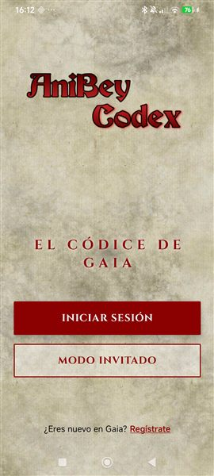
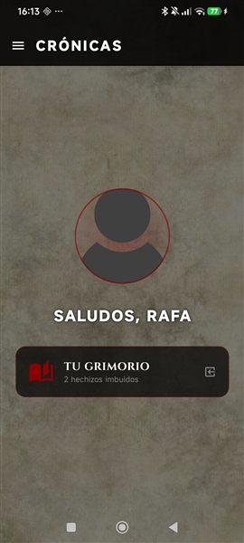
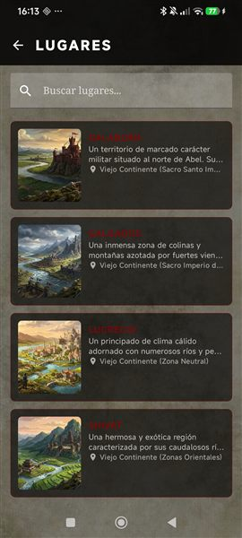
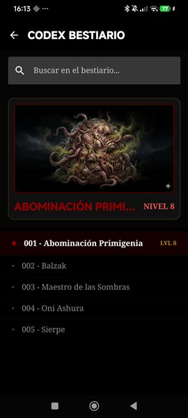
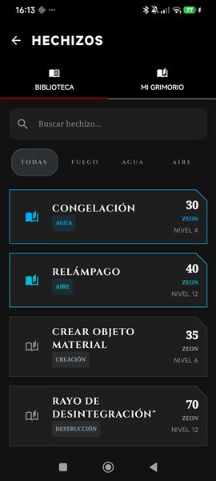
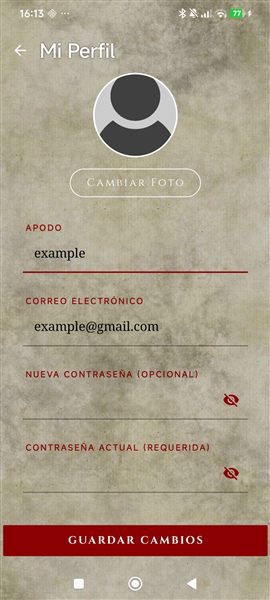

# AniBey Codex

Aplicación Android de consulta para **Anima Beyond Fantasy**, desarrollada como Trabajo de Fin de Grado del ciclo de **Desarrollo de Aplicaciones Multiplataforma (2.º DAM)**. Reúne información de ambientación y herramientas de consulta para acompañar las partidas de rol desde el móvil.

> La aplicación consulta su contenido en Firebase. No necesitas configurar Firebase para usarla; las funciones de cuenta requieren registrarse e iniciar sesión desde la propia app.

## Contenido

- [Qué puedes hacer](#qué-puedes-hacer)
- [Requisitos](#requisitos)
- [Instalación y ejecución](#instalación-y-ejecución)
- [Configuración para desarrolladores](#configuración-para-desarrolladores)
- [Cómo se organiza el proyecto](#cómo-se-organiza-el-proyecto)
- [Tecnologías](#tecnologías)
- [Pruebas](#pruebas)
- [Capturas de pantalla](#capturas-de-pantalla)
- [Licencia y atribución](#licencia-y-atribución)
- [Contacto](#contacto)

## Qué puedes hacer

- **Explorar Gaia:** consultar lugares y su información de detalle.
- **Consultar el bestiario:** buscar criaturas por nombre o categoría y abrir sus fichas.
- **Usar el grimorio:** consultar hechizos, filtrarlos por rama mágica o nombre y ver sus detalles.
- **Guardar hechizos:** añadirlos o quitarlos del grimorio personal de una cuenta registrada.
- **Gestionar una cuenta:** registrarse con verificación de correo, iniciar sesión, solicitar un restablecimiento de contraseña y editar el perfil.
- **Actualizar la foto de perfil:** elegir una imagen de la cámara o de la galería.
- **Entrar como invitado:** acceder a lugares y al bestiario sin crear una cuenta.

El perfil y el grimorio personal requieren una sesión registrada. El contenido de lugares, criaturas y hechizos se carga desde Firestore; el proyecto no incluye un catálogo local de datos para utilizar sin conexión.

## Requisitos

Para instalar y utilizar la aplicación basta con un dispositivo Android compatible y conexión a Internet. **No necesitas crear una cuenta de Firebase ni configurar nada en Firebase Console**: la aplicación de este repositorio ya incluye la configuración necesaria para conectarse al proyecto Firebase asociado.

Si quieres compilar el proyecto desde el código fuente, necesitarás además:

- Android Studio con soporte para proyectos Android y Kotlin.
- JDK 17.
- Android SDK 36 instalado.
- Un emulador o dispositivo Android con API 24 o posterior.

La configuración Android del proyecto compila con `compileSdk 36`, tiene `minSdk 24` y `targetSdk 36`. Algunas acciones del perfil pueden solicitar permiso para acceder a la cámara o a imágenes.

## Instalación y ejecución

1. Clona el repositorio y ábrelo en Android Studio:

   ```bash
   git clone https://github.com/RafaelReyesOrtiz/AniBey_Codex.git
   cd AniBey_Codex
   ```

   Si ya tienes una copia del proyecto, puedes abrir directamente esa carpeta. Android Studio sincronizará las dependencias de Gradle.

2. Ejecuta la configuración `app` desde Android Studio, o compila desde la terminal:

   **Windows (PowerShell):**

   ```powershell
   .\gradlew.bat :app:assembleDebug
   ```

   **macOS o Linux:**

   ```bash
   ./gradlew :app:assembleDebug
   ```

   El APK de depuración se genera en `app/build/outputs/apk/debug/`.

## Configuración para desarrolladores

Este repositorio incluye `app/google-services.json`, que configura la aplicación para conectarse al proyecto Firebase del desarrollador. Por tanto, **no tienes que registrar una aplicación Android en Firebase para compilar y ejecutar este proyecto tal como está**. Los datos accesibles y las operaciones permitidas dependen de las reglas de seguridad de ese proyecto.

Si haces un *fork* y quieres conectar tu copia a **tu propio** proyecto Firebase, registra allí una app Android con el identificador `com.example.anibey_codex_tfg`, descarga su `google-services.json` y reemplaza el archivo incluido. Tu proyecto deberá tener habilitados Firebase Authentication (correo y contraseña), Cloud Firestore y Firebase Storage.

<details>
<summary>Estructura de datos esperada en Firestore</summary>

| Ruta | Campos utilizados |
| --- | --- |
| `users/{uid}` | `email`, `username`, `photoUrl` y `grimorio` (lista de identificadores de hechizos guardados). |
| `lugar/{id}` | `nombre`, `descripcion`, `tipo`, `region`, `imagenURL`, `personajes` y `monstruos`. |
| `monstruos/{id}` | `nombre`, `descripcion`, `categoria`, `nivel`, `habitat`, `imagenURL`, `habilidades` y `debilidades`. |
| `hechizos/{id}` | `nombre`, `ramaMagia`, `nivel`, `tiempoCasteo`, `zeonCost`, `rango`, `descripcion` y `efecto`. |

Los identificadores de documento se utilizan como identificadores de lugares, criaturas y hechizos. Los nombres de colección deben respetarse exactamente. Las reglas de Firestore y Storage dependen de la política del proyecto Firebase; no se deben publicar reglas abiertas en producción.

</details>

## Cómo se organiza el proyecto

El código de la aplicación está en `app/src/main/java/com/example/anibey_codex_tfg/`:

- `ui/screens/`: pantallas y sus estados/viewmodels, agrupados por función (bienvenida, autenticación, inicio, perfil, lugares, bestiario y grimorio).
- `ui/navigation/`: destinos y navegación entre pantallas.
- `ui/common/`: componentes reutilizables, tema visual y utilidades de interfaz.
- `domain/model/`: modelos de perfil, lugar, criatura y hechizo.
- `data/`: configuración de dependencias y persistencia local de la sesión con DataStore.
- `app/src/main/res/`: recursos visuales, fuentes y temas de Android.

La interfaz está construida con Jetpack Compose y sigue un enfoque MVVM: las pantallas muestran estado expuesto por sus ViewModels, mientras que Hilt proporciona las dependencias de Firebase y Android.

## Tecnologías

- Kotlin y Android Gradle Plugin.
- Jetpack Compose y Material 3.
- Navigation Compose y Kotlin Serialization.
- ViewModel y StateFlow.
- Hilt y KSP para inyección de dependencias.
- Firebase Authentication, Cloud Firestore y Firebase Storage.
- Preferences DataStore para conservar la sesión local.
- Coil para cargar imágenes.
- JUnit, AndroidX Test y Espresso para pruebas.

## Pruebas

Para ejecutar las pruebas unitarias locales:

**Windows (PowerShell):**

```powershell
.\gradlew.bat :app:testDebugUnitTest
```

**macOS o Linux:**

```bash
./gradlew :app:testDebugUnitTest
```

Las pruebas instrumentadas requieren un dispositivo o emulador conectado y pueden ejecutarse con `:app:connectedDebugAndroidTest`.

## Capturas de pantalla

Las capturas completas están en `docs/screenshots/` y las miniaturas de esta galería en `docs/screenshots/thumbnails/`. Pulsa una miniatura para abrir la captura completa.

<table>
  <tr>
    <td align="center"><a href="./docs/screenshots/bienvenida.jpg"></a><br><strong>Bienvenida y acceso</strong></td>
    <td align="center"><a href="./docs/screenshots/inicio.jpg"></a><br><strong>Inicio</strong></td>
    <td align="center"><a href="./docs/screenshots/lugares.jpg"></a><br><strong>Lugares</strong></td>
  </tr>
  <tr>
    <td align="center"><a href="./docs/screenshots/bestiario.jpg"></a><br><strong>Bestiario</strong></td>
    <td align="center"><a href="./docs/screenshots/grimorio.jpg"></a><br><strong>Grimorio</strong></td>
    <td align="center"><a href="./docs/screenshots/perfil.jpg"></a><br><strong>Perfil</strong></td>
  </tr>
</table>

## Licencia y atribución

Este es un proyecto académico y personal, creado para compartirlo con grupos de rol y mostrar mi trabajo como desarrollador. **No se ha definido una licencia formal para este repositorio**; su publicación en GitHub no implica por sí sola autorización para reutilizar, modificar o redistribuir el código o sus recursos.

*Anima Beyond Fantasy* y los materiales de terceros que puedan aparecer en la aplicación pertenecen a sus respectivos titulares. Este proyecto no es oficial ni está destinado a la comercialización. Si se añaden o reutilizan recursos de terceros, deben respetarse las condiciones y atribuciones que correspondan.

## Contacto

**Nombre:** Rafael Reyes \
**Rol:** Desarrollador Android · DAM\
**LinkedIn:** [Perfil de LinkedIn](https://www.linkedin.com/in/rafael-ignacio-reyes-ortiz-9a10792aa)
